# Tanishk S Pandey

B.Tech CSE student at NIT Jamshedpur (2024 batch).

[GitHub](https://github.com/HanuP69) · [Codeforces](https://codeforces.com/profile/tan69) · [LinkedIn](https://in.linkedin.com/in/tanishk-s-pandey-17a007339)

 

## Tech Stack

**Languages:**

**Web:**

**ML / DL:**

**CP / DSA:**

**Tools:**

## Projects

<!-- Yahan apne 3-5 best repos list karo, is format mein:
- [repo-name](https://github.com/HanuP69/repo-name): ek line mein kya karta hai
-->

All repositories: [github.com/HanuP69?tab=repositories](https://github.com/HanuP69?tab=repositories)

## GitHub Stats

  
  
  

## Competitive Programming

Codeforces: [tan69](https://codeforces.com/profile/tan69)

## Contact

[GitHub](https://github.com/HanuP69) · [Codeforces](https://codeforces.com/profile/tan69) · [LinkedIn](https://in.linkedin.com/in/tanishk-s-pandey-17a007339)
